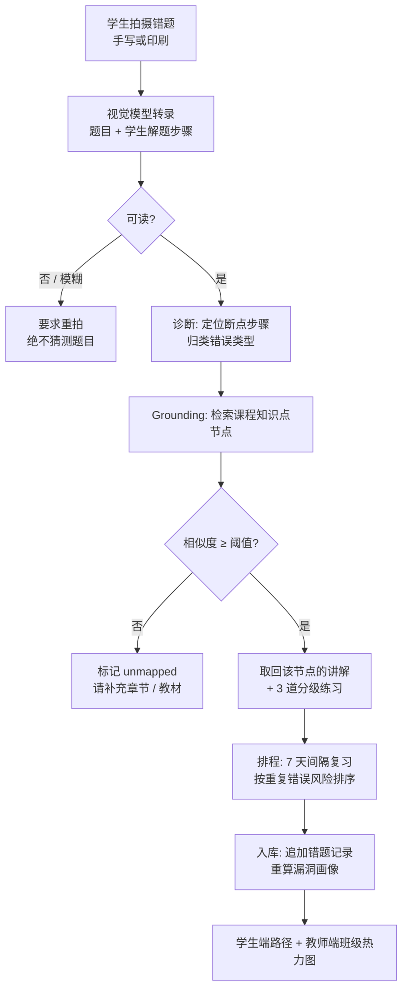

# Pathfinder AI · 每一个错题，都是一张学习地图

> **参赛赛道**：教育与文化创意（Education & Cultural Creativity）
> **赛事**：智賦香江 AI 智能體應用大賽 · Hong Kong AI Agent Challenge: Agents in Action（香港数码港 Cyberport）
> **团队**：KK_garden　|　**可运行代码**：https://github.com/Hkate777/pathfinder-agent-edu

**一句话**：学生拍下一道做错的题，AI 不只给答案，而是定位「哪一步的思路断了」，从课程知识图谱中取回对应知识点与分级练习，并生成一条 7 天个性化复习路径；读不清就要求重拍，匹配不到就如实标记，绝不编造。

**English summary** — Pathfinder AI turns a single photo of a wrong answer into a structured diagnosis: the exact broken reasoning step, an error-type label from a closed taxonomy, a syllabus-grounded knowledge point, retrieved graded practice, and a 7-day spaced review path. Teachers get a class-level gap heatmap. The agent abstains on unreadable work and reports unmapped knowledge points instead of hallucinating — a safety-first design aligned with the education track.

## 本地工作台

```bash
python -m pip install -r requirements.txt
python -m streamlit run app.py --server.address 127.0.0.1
```

打开 [本地工作台](http://localhost:8501)。无 API 密钥时可使用内置示例和手动录入，界面会标注「离线规则基线」。

- **诊断台**展示原始解题步骤、定位到的断点、课程知识点及结果来源。照片先转录，核对后再提交诊断。
- **复习路径**从最近的可练诊断或教师确认起算，按薄弱点优先级推荐第 1、3、7 天的题库练习。到期后可对照参考解法并记录掌握情况，每天最多记录配置数量的不同练习。
- **错题档案**保存诊断结果、14 天重复错误率与教师意见。**班级学情**按班级和错误类型显示热力图。**复核队列**支持确认或退回，处理意见会追加到原记录。

在侧栏「学生资料」可选择学生编号并为当前学生设置班级。学生与教师入口用于本地演示，面向实际学校部署时需要独立的账号和权限层。

要启用照片转录，复制 `.env.example` 为 `.env`，填写兼容端点、模型及密钥，并设置 `PATHFINDER_OFFLINE=0` 后重启。照片转录会将图片发送给配置的视觉服务。成功入库的照片保存在 SQLite 数据库所在目录的 `uploads/` 下。

```bash
python -m unittest discover -s tests
python diagnose.py --sample samples/alg_distributive.json --offline --no-save
python eval.py --set samples
# 启用在线模型后，可评估已转录样本的诊断和知识点匹配
python eval.py --set samples --online
```

---

## 参赛信息速览

| 项目 | 内容 |
|---|---|
| 赛道 | 教育与文化创意 |
| 报名期 | 2026.10.20 – 2027.01.03 |
| 参赛者简报会 | 2026.11.25 15:00–16:00 HKT |
| 入围评审 | 2027.01.03 – 01.29 |
| 复赛 | 2027.02.22 – 02.28 |
| 决赛与颁奖 | 2027.03 |
| 提交物 | PPT 计划书（中/英）+ Demo 视频（可在线链接） |
| 团队规模 | ≤ 5 人（不含指导老师） |

**提交邮箱**：aiagent_contest@cyberport.hk
**邮件标题**：申请编号-智能体应用大赛提案提交
**报名链接**：https://forms.cloud.microsoft/r/iR4i3y9GOY

---

# 一、项目基本信息

- **项目名称**：Pathfinder AI（错题导航智能体）
- **简介**：面向中小学生与教师的多模态错题诊断智能体。输入一张错题照片（题目 + 学生自己的解题步骤），输出「断点步骤 + 错误类型 + 课程知识点 + 分级练习 + 7 天复习路径」，并把每次错题沉淀为可持续更新的知识漏洞画像。
- **核心差异**：不是解题器，而是「诊断器」。答案错了不重要，重要的是定位推理在哪一步断裂——那才是教学发生的地方。
- **团队组成与核心分工**（提交前请替换为真实姓名）：

| 角色 | 分工 |
|---|---|
| 教育产品 / 场景负责人 | 课程知识点体系设计、教师场景调研、试点学校对接 |
| AI 工程师 | 诊断管线、知识图谱 grounding、可插拔模型层 |
| 全栈 / 交互工程师 | 学生端与教师端界面、可视化、部署 |
| 数据与评估负责人 | 样本标注、评估脚本、trace 存档与指标定义 |
| （可扩展至 5 人）指导老师 | 教学法与合规把关，不计入 5 人上限 |

---

# 二、行业痛点、业务挑战

## 2.1 痛点

- **学生**：「很努力但反复错同一类题」。传统错题本只抄下正确答案，不回答「我当时哪一步想错了」，于是同样的错误反复发生。
- **教师**：一个班 40 人，无法逐一诊断每道错题的思维断点；即使想分层讲解，也缺少结构化的班级薄弱点数据。
- **现有工具**：拍照搜题类应用给答案，不给诊断；大模型直接问答会编造知识点与练习题，且脱离教学大纲，教师不敢用。

## 2.2 使用场景与目标客户

| 维度 | 说明 |
|---|---|
| 目标客户 | 中小学生（K-12，起步为数学 / 科学 / 英语）、一线教师、教研与教培机构 |
| 使用场景 | 课后作业订正、考前错题复盘、课堂随测后的分层巩固、家教/培优的学情诊断 |
| 赛道契合 | 教育与文化创意——把 AI 智能体用于「个性化学习路径」这一真实教育问题，而非通用问答 |

## 2.3 使用流程（端到端）



## 2.4 典型案例

一道代数错题：`2(x+3) = 4x - 6`，学生写成 `2x + 3 = 4x - 6` → `3 = 2x - 6` → `x = 4.5`。

系统把断点定位在第一步去括号，并输出结构化诊断（历史运行记录）：

```json
{
  "status": "ok",
  "question": "Find the value of x: 2(x+3) = 4x - 6",
  "steps": ["2x + 3 = 4x - 6", "3 = 2x - 6", "x = 4.5"],
  "broken_step": "2x + 3 = 4x - 6",
  "error_type": "conceptual",
  "knowledge_point": "ALG-7.3",
  "confidence": 0.9,
  "practice": ["ALG-7.3 #1 (easy)", "ALG-7.3 #2 (medium)", "ALG-7.3 #3 (applied)"],
  "schedule": [
    {"day": 1, "item_id": "ALG-7.3 #1"},
    {"day": 3, "item_id": "ALG-7.3 #2"},
    {"day": 7, "item_id": "ALG-7.3 #3"}
  ],
  "flags": {"unmapped": false, "provider": "offline-rule-baseline", "grounding_score": 0.8621}
}
```

断点被定位在「去括号」这一步（分配律没乘进括号内的 3），而不是最终算错的 `x=4.5`——这正是教师会圈出来的那一步。

---

# 三、技术方案

## 3.1 技术架构与设计

单一核心管线 `diagnose.py`，薄适配层分离（`app.py` 为 Streamlit UI，CLI 为 `diagnose.py::main`）。核心原则写进 `AGENTS.md`：**管线中任何环节都不得编造**。

| 模块 | 职责 |
|---|---|
| `vision.py` | 照片转录，显式状态 `ok / ambiguous / unreadable / rotated`；非 `ok` 直接短路 |
| `llm.py` | 可插拔推理层：`OpenAICompatProvider`（chat+vision+embedding）与 `StubProvider`（离线规则基线）；每类失败都有独立异常类 |
| `grounding.py` | 课程知识点检索：正则匹配 + embedding 相似度，带阈值判定，低于阈值一律 `unmapped` |
| `schedule.py` | 风险排序 + 7 天间隔排程（day 1/3/7），每天 ≤ 3 题 |
| `store.py` | SQLite：追加错题和复核意见、漏洞画像重算、练习日志、14 天重复错误率、班级热力图 |
| `ui.py` / `ui.css` | 工作台的展示组件与样式 |
| `knowledge_base/` | 10 个课程知识点节点（数学 6 / 物理 2 / 化学 1 / 英语 1），每节点 3 道分级题 + 匹配规则 |
| `eval.py` / `tests/` | 离线评估、可选在线评估、诊断与工作台回归测试 |

## 3.2 核心工作流

1. **Parse**：视觉模型转录题目与学生步骤，保留原始记号与错误，不擅自修正。
2. **Diagnose**：要求模型引用「第一个出错的步骤」，错误类型输出为闭集 `conceptual / procedural / careless / unreadable`。
3. **Ground**：把题目+步骤（含模型给出的知识点提示）与课程知识图谱比对；相似度 ≥ 阈值才认定知识点。
4. **Prescribe**：练习题**从知识库取回**，禁止模型自由生成——避免脱离大纲与无人批改的「伪练习」。
5. **Schedule**：按 `risk = 重复次数 × 时间衰减 × 错误严重度(概念3/过程2/粗心1) × 0.5^已清除数` 排序，分布到 day 1/3/7。
6. **Store**：错题记录只增不改，画像每次重算，保证纵向重复错误率可测。

## 3.3 工具调用方案

- **视觉**：`VISION_MODEL`（默认 `gpt-4o-mini`），base64 图片传入 OpenAI 兼容 `/chat/completions`。
- **文本诊断**：`TEXT_MODEL`（默认 `gpt-4o-mini`），system prompt 强制 JSON schema 与闭集分类，temperature=0。
- **Embedding**：`EMBEDDING_MODEL`（默认 `text-embedding-3-small`），用于知识点检索。
- **可插拔**：任意 OpenAI 兼容端点，换供应商只改 `.env`，不改代码。密钥仅在本地 `.env`（已 git-ignore），仓库内无任何 key。
- **离线降级**：无 key 时自动切到 `StubProvider`（确定性规则基线），所有输出标注 `provider: offline-rule-baseline`，永不被当作模型诊断展示。

## 3.4 交互设计

- **学生端**：上传/示例选择 → 诊断卡（错误类型、断点步骤、置信度、讲解）→ 7 天路径 → 个人漏洞画像与 14 天重复错误率。
- **教师端**：班级知识点热力图（哪些知识点错得最多）、低置信度/未映射用例提示，支持人工复核。
- **诚实交互**：照片读不清 → 重拍提示；知识点未映射 → 提示补充章节；低置信度 → 标记「需教师复核」。失败是明确状态，不是静默降级。

## 3.5 创新点

1. **诊断的是断点，不是答案**：结构化输出要求引用具体出错步骤，把一个错题变成可计算的数据。
2. **Grounded 出题**：练习来自课程知识图谱而非模型生成，保证「可教、可批改、不超纲」。
3. **诚实失败（Abstention）**：读不清/匹配不到/低置信度各有专属状态；宁可说「不知道」，绝不编造知识点——在教育场景，自信的错误比没有答案更有害。
4. **间隔复习 + 风险排序**：把教育心理学的 spaced retrieval 固化为 day 1/3/7 排程，并每天限量，避免路径被抛弃。
5. **可审计的纵向画像**：append-only 错题 + 重算画像 + 完整 trace，让「14 天重复错误率」这一真实教育指标可被验证。

---

# 四、预期成果

## 4.1 预期影响与业务 / 社会价值

- **社会价值**：对齐 SDG 4 优质教育。把「一对一诊断」从稀缺资源变成每个学生的日常能力，缩小因师资不足造成的学情盲区。
- **业务价值**：面向学校/教培的 SaaS 化潜力——班级热图为教研提供数据资产；个性化路径提升续课与口碑。
- **可量化成效**：核心指标 **14 天重复错误率**（`store.repeat_error_rate`）；辅助指标：教师诊断耗时、路径完成率、学生自评信心。

## 4.2 落地路径

1. **阶段一（现状）**：MVP 全链路跑通，10 节点知识库、44 项测试、7 样本评估与 trace 存档。
2. **阶段二**：接入真实多模态模型，完成 100 张照片解析准确率评估 + 2 位教师独立标注的 Cohen's κ 一致性研究。
3. **阶段三**：合作学校 200 人试点（实验班用 Pathfinder 路径 vs 对照班常规复习），主终点为 14 天重复错误率，记录教师工时。
4. **阶段四**：课程本地化（对接香港 DSE / 本地课程与中英双语）、平台化部署、商业化与创业孵化路径。

## 4.3 Demo 与可运行入口

- 代码仓库（可运行、含测试与 trace）：https://github.com/Hkate777/pathfinder-agent-edu
- 本地运行：

```bash
pip install -r requirements.txt
cp .env.example .env          # Windows: copy .env.example .env
python diagnose.py --sample samples/alg_distributive.json --trace   # 无 key 也可跑
python -m unittest discover -s tests                                 # 44 项离线测试，零 API 消耗
python eval.py --set samples --save                                  # 开发样本评测（规则同源）
python eval.py --set challenge                                       # 独立挑战集（探测泛化差距）
streamlit run app.py                                                 # 学生 + 教师界面
```

- Demo 视频（2–4 分钟）：待录制后填入在线链接。

---

# 五、鼓励提交材料

## 5.1 过往项目经验

本项目原型在赛前已完整建成并用于另一项 AI 应用赛事，具备可验证的落地基础：全链路管线、10 节点课程知识库、44 项离线测试、7 个开发样本 + 12 个独立 challenge 用例、7 份存档 trace；复查中定位并修复 7 处工程漏洞及阶段 0 的 4 个 UI 阻断项（详见 [REVIEW.md](REVIEW.md) 与 [ASSESSMENT_AND_ROADMAP.md](ASSESSMENT_AND_ROADMAP.md)）。团队具备全栈原型、LLM/RAG 工程与教育场景对接能力。

## 5.2 原创性与资源使用声明

| 类别 | 说明 |
|---|---|
| 赛前已有 | Pathfinder AI 管线、知识库、测试、trace（原仓库 `kk-garden-pathfinder`）；本次新增赛道定位、香港课程本地化规划、计划书与合规复查 |
| 赛期新增 | 面向 Cyberport「教育与文化创意」赛道的定位、计划书/PPT、本仓库 `pathfinder-agent-edu` |
| 模型 | 用户自备 OpenAI 兼容端点（VISION/TEXT/EMBEDDING 模型可配置）；无 key 时使用自研确定性规则基线，且明确标注 |
| 数据 | 7 个自编/教师标注样本 + 自编 10 节点课程知识库；仓库内无学生真实个人数据 |
| 代码与依赖 | 核心代码原创；依赖 streamlit / requests / pillow / python-dotenv；无外部训练数据、无第三方接管服务 |
| 数据存储 | 密钥来自本地 `.env` 或环境变量。已保存的照片保留在本机，转录请求会发送给配置的视觉服务 |

## 5.3 技术佐证材料

- `traces/`：4 条单次运行 + 3 份评估报告（真实存盘）
- `tests/`：44 项离线单元与工作台回归测试，零 API 消耗
- `samples/`：7 个开发样本（6 个错题 + 1 个不可读；规则据此编写）
- `evaluation/classroom_challenge.json`：12 个独立编写的挑战用例（无独立教师校验，用于探测泛化差距）
- `AGENTS.md`：开发规范与 7 条不可逾越线

---

# 六、评审标准对照

| 评审维度 | 权重 | 本项目对应支撑 |
|---|---|---|
| 技术创新与安全 | 30% | 断点级结构化诊断、grounding 阈值、闭集分类、诚实失败/弃答、append-only 审计、provider 标注、可插拔模型层 |
| 功能和用户体验 | 25% | 学生端上传→诊断→7 天路径→画像；教师端热力图；重拍/未映射/低置信度三类诚实提示；每天限量 |
| 应用场景适配度 | 25% | 教育与文化创意赛道；大纲对齐知识图谱；师生双端；间隔复习贴合作业订正与考前复盘流程 |
| 商业价值与社会影响 | 20% | SDG 4；14 天重复错误率可量化；教师工时节省；学校/教培 SaaS 化与创业孵化路径 |

---

# 七、已验证证据（真实 trace）

| Trace | 输入 | 错误类型 | 知识点 | Grounding | 结果 |
|---|---|---|---|---|---|
| `20261031_145853_alg_distributive` | `2(x+3)=4x-6` → `2x+3=4x-6` → `x=4.5` | conceptual | ALG-7.3 | 0.8621 | 定位断点，3 题排程 day 1/3/7 |
| `20261031_145853_phy_unit_conversion` | 500g、10N，`a=F/m=10/500` | procedural | PHY-9.2 | 0.5856 | 单位换算被标记，路径生成 |
| `20261031_145854_unreadable_photo` | 空 / 不可读输入 | unreadable | — | — | **不产诊断**，返回重拍请求 |
| `eval_20261031_145842` | 全部 7 样本 | 类型 6/6、知识点 6/6 | — | — | 断点定位 6/6，1 例按设计重拍 |
| `python -m unittest discover -s tests` | 44 项离线测试 | — | — | — | 全部通过，零 API 消耗 |
| `python eval.py --set challenge` | 12 个独立挑战用例 | 6/8 (75%) | 7/8 (88%) | — | 断步 6/8，路由 10/12；暴露规则基线的泛化短板 |
| `eval_samples_20261119_082419`（在线·hy4-flash-free·哈希检索） | 7 开发样本 | 4/6 (67%) | 5/6 (83%) | — | 断步 6/6、路由 7/7；首个真实模型对照 |
| `eval_challenge_20261119_085931`（**在线·hy4-flash-free·语义检索**） | 12 挑战用例 | 4/8 (50%) | **8/8 (100%)** | — | 断步 **8/8**、路由 11/12；false blame 1/3 |
| `eval_samples_20261119_085626`（在线·hy4-flash-free·语义检索） | 7 开发样本 | 3/6 (50%) | **6/6 (100%)** | — | 断步 6/6、路由 7/7 |

> **引用前必读**：离线数字来自 **规则基线**（`offline-rule-baseline`），规则针对 `samples/` 编写——`samples` 6/6 验证的是**管线接线**，不是模型精度；`challenge` 8/8 是泛化信号。在线数字来自 **OpenCode Go 免费模型 hy4-flash-free**，为**混合模式**（诊断=真实模型，grounding=本地 Sentence-Transformers 语义检索，标注 `openai-compatible+local-st`），样本量仅 7/12、无独立教师校验，**不构成产品结论**。同批对比：换回哈希检索时 challenge 知识点为 7/8；语义检索把中文题从 0/6 提升到 6/6。真实多模态模型的一致性评估（Cohen's κ）待留出集与双标注到位后运行。

---

# 八、数据模型

| 表 / 文件 | 关键字段 | 用途 |
|---|---|---|
| `students` | `id`, `grade`, `class_id` | cohort 与看板分组 |
| `mistakes` | `broken_step`, `error_type`, `knowledge_point_id`, `confidence`, `grounded`, `provider` | 原始证据，append-only |
| `practice_log` | `mistake_id`, `item_id`, `due_day`, `result` | 掌握状态，驱动排程 |
| `mistake_details` | `mistake_id`, `explanation`, `grounding_score`, `needs_review`, `source` | 保存新增诊断证据与输入来源 |
| `teacher_reviews` | `mistake_id`, `decision`, `note`, `reviewed_at` | 保留确认或退回意见 |
| `knowledge_points.json` | 标题、关键词、讲解、3 道分级题 | 课程知识图谱（10 节点） |

主指标：**重复错误率**——14 天内同一知识点再次作为新错题出现的比例（`store.repeat_error_rate`，已单测）。辅助指标：教师诊断耗时、路径完成率、学生信心。

---

# 九、失败与限制政策

鉴权失败、配额耗尽、网络错误和响应格式错误会显示对应的处理提示。不可读照片请求重拍，找不到匹配知识点时显示「暂未映射」。只有能引用原文的断点才会高亮。低置信度、缺少可靠断点或未映射的记录进入复核队列，低置信度或缺少可靠断点的诊断经教师确认后才会启用已映射的练习。

---

# 十、路线图

- [x] 概念、管线设计、诊断 schema
- [x] 闭集错误分类、grounding 阈值、排程规则
- [x] 全链路实现：解析 → 诊断 → grounding → 出题 → 排程 → 存储
- [x] 课程知识库（10 节点 / 30 道分级题）+ 离线匹配器
- [x] 学生端与教师端界面：上传、诊断卡、7 天路径、画像、班级热力图
- [x] 离线单元测试、工作台回归测试与样本评估（含存档 trace）
- [ ] **真实多模态模型运行** —— 待 API key，替换本页基线数字
- [ ] 100 张照片解析准确率 + 教师诊断一致性（Cohen's κ）研究
- [ ] 200 人试点（合作学校）
- [ ] Demo 视频（2–4 分钟）
- [ ] 香港课程 / DSE 与中英双语本地化

---

**团队 KK_garden** —— 全栈原型、LLM & RAG 工程、教育场景对接。
开发规范见 [AGENTS.md](AGENTS.md) · 合规复查见 [REVIEW.md](REVIEW.md)。
